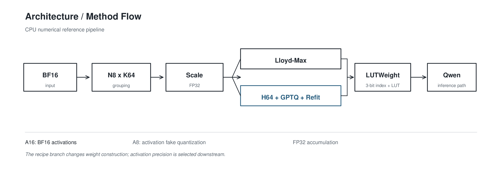
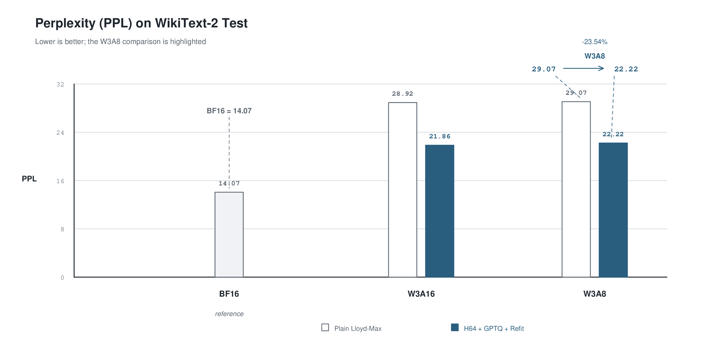
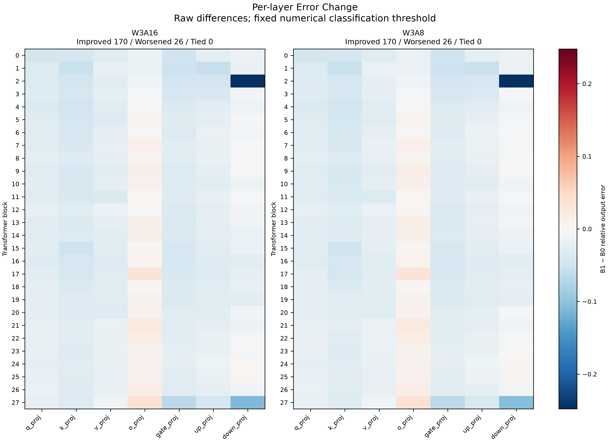

# Rubin LUT-W3A8/W3A16 CPU Numerical Reference

This repository contains a CPU numerical reference for LUT-based W3A8 and
W3A16 configurations used in a Rubin-related study. It models the logical
behavior and quantization recipe defined by this project; it is not a hardware
emulator and does not make throughput, latency, energy, CUDA, PTX, or Tensor
Core claims. The repository includes the implementation, tests,
reproducibility checks, and recorded evaluation artifacts for inspection and
reruns.

The numerical definition is documented in
[`docs/numerical_spec_v1.md`](docs/numerical_spec_v1.md). The
[reference report](docs/final_report.md) covers the original three-mode
experiment; the [recipe comparison](docs/quantization_comparison.md) and
[Plan A results](docs/layerwise_diagnostics.md) cover the subsequent accepted
experiments. See the [acceptance record](docs/acceptance.md) for their separate
evidence and scope.

The latest accepted execution completed on 2026-10-14: all eight historical
evaluations reproduced exactly, 91 tests passed without skips, and Plan A
passed its 1,024-token smoke and 4,096-token validation runs.

## Environment and model

The recorded environment is Python 3.14 (`.python-version`) with dependencies
frozen by [`uv.lock`](uv.lock):

```bash
uv sync --locked --extra plots
```

Place the local checkpoint at `models/Qwen3-0.6B-Base`. The evaluator always
uses `local_files_only=True`; it does not download or substitute another
model. Historical reproduction requires the original checkpoint, tokenizer,
and cached WikiText-2 data; their frozen revisions and fingerprints are recorded
in [resource provenance](results/historical_rerun/resource_provenance.json).
The plotting extra installs the Matplotlib renderer for Plan A.

## Tests and sanity checks

```bash
uv run --extra plots pytest -q
uv run python scripts/sanity_linear.py
uv run python scripts/sanity_block.py --model-path models/Qwen3-0.6B-Base
```

The evaluator and full-model sanity path accept only `--device cpu`.

## Reproduce the recorded results

The recorded protocol uses Qwen3-0.6B-Base, WikiText-2 raw test, 1024-token
sequences, 32768 evaluation tokens, seed 42, and CPU-only execution:

```bash
uv run python scripts/eval_qwen.py --mode bf16 \
  --model-path models/Qwen3-0.6B-Base --dataset Salesforce/wikitext \
  --dataset-config wikitext-2-raw-v1 --split test --seq-len 1024 \
  --max-eval-tokens 32768 --device cpu --seed 42 \
  --output results/bf16.json

uv run python scripts/eval_qwen.py --mode w3a8 \
  --model-path models/Qwen3-0.6B-Base --dataset Salesforce/wikitext \
  --dataset-config wikitext-2-raw-v1 --split test --seq-len 1024 \
  --max-eval-tokens 32768 --device cpu --seed 42 \
  --output results/w3a8.json

uv run python scripts/eval_qwen.py --mode w3a16 \
  --model-path models/Qwen3-0.6B-Base --dataset Salesforce/wikitext \
  --dataset-config wikitext-2-raw-v1 --split test --seq-len 1024 \
  --max-eval-tokens 32768 --device cpu --seed 42 \
  --output results/w3a16.json

uv run python scripts/compare_results.py \
  results/bf16.json results/w3a8.json \
  --w3a16-json results/w3a16.json \
  --output results/summary.csv \
  --attribution-output results/attribution.csv
```

`compare_results.py` refuses to write a summary when required experiment
metadata differs or when `ppl` is not consistent with `exp(mean_nll)`.

## Recorded reference result

| Mode | mean NLL | PPL | Δmean NLL | ΔPPL |
|---|---:|---:|---:|---:|
| BF16 | 2.64401770896576 | 14.069617833591494 | — | — |
| LUT-W3A16 | 3.3644417383337535 | 28.917349344449057 | 0.7204240293679933 | 14.847731510857564 |
| LUT-W3A8 | 3.3695883653031067 | 29.066559790365766 | 0.7255706563373465 | 14.996941956774272 |

Machine-readable results and acceptance logs are in
[`results/`](results/). `results/attribution.csv` reports mean-NLL deltas for
weight quantization, activation quantization on W3 weights, and total
quantization. The complete interpretation and limitations are in
[`docs/final_report.md`](docs/final_report.md).

The 1.2 GB model weight file is intentionally not committed to Git. Supply it
separately at `models/Qwen3-0.6B-Base`.

## Publication figures

The following English academic-style figures summarize the fixed comparison.
They are generated from
[`results/quantization_comparison/summary.csv`](results/quantization_comparison/summary.csv):



*Figure 1. Architecture and method flow for the shared BF16 input path and the two W3 recipes.*



*Figure 2. PPL comparison, highlighting the W3A8 change from 29.07 to 22.22 while retaining the BF16 reference at 14.07.*

The complete five-row table is also available as the standalone PNG artifact
[`results/figures/main_results_table.png`](results/figures/main_results_table.png);
it is not embedded here because the README already contains the corresponding
numeric tables. Regenerate all figures with:

```bash
python3 scripts/generate_figures.py
```

The figure renderer requires Ghostscript (`gs`) and emits high-resolution PNG
exports.

## Additional quantization comparison

A separate CPU experiment compares plain Lloyd-Max with signed H64 + K64
GPTQ + Hessian-refitted E4M3 LUTs, each in W3A16 and W3A8, sharing BF16.
It preserves this project's FP32 K64 scale rules and the original results.

```bash
uv run python -m scripts.run_quantization_comparison
```

Both WikiText-2 train and test must already be cached; evaluation is offline.
See [experiment protocol](docs/quantization_comparison.md) for the fixed
512-token train calibration, payload reuse, reference-source differences,
and reproducibility instructions.

Recorded comparison (shared BF16 PPL: 14.0696):

| Recipe | W3A16 PPL | W3A8 PPL |
|---|---:|---:|
| plain Lloyd-Max | 28.9173 | 29.0666 |
| H64 + GPTQ + refitted LUT | 21.8577 | 22.2245 |

The original comparison acceptance recorded 42 passing tests. The latest
engineering acceptance records [91 passing tests](results/layerwise_diagnostics/implementation_acceptance.json),
including the original regressions and Plan A checks. The
[complete historical rerun](results/historical_rerun/20261013/report.md)
executed the three original rows and all five comparison rows with 20
evaluation threads; every mean-NLL and PPL delta was exactly zero.

## Plan A layer diagnostics

The fixed protocol is in [docs/update_plan_a.md](docs/update_plan_a.md), and the
accepted measurements and interpretation are in
[docs/layerwise_diagnostics.md](docs/layerwise_diagnostics.md).
Plan A observes the original BF16 teacher and runs each local W3A16/W3A8 pair
using one cached weight reconstruction. It includes unquantized numerical
controls, fixed CSV schemas, signed A8-versus-Teacher MSE changes, independent
weight checks, and separate implementation/experiment acceptance.

Record independent engineering acceptance before the model experiments:

```bash
uv run --extra plots python -m scripts.check_layerwise_implementation
```

To repeat all accepted historical configurations first, the historical runner
executes the original BF16/W3A16/W3A8 rows, then the five-row comparison. It
checks checkpoint, tokenizer, token and payload fingerprints and refuses
historical NLL/PPL drift. Existing recorded results remain the comparison
source. Use the payloads from that successful rerun for Plan A:

```bash
HF_DATASETS_CACHE=models/wiki-cache uv run --extra plots \
  python -m scripts.reproduce_history \
  --output-dir results/historical_rerun/run && \
HF_DATASETS_CACHE=models/wiki-cache uv run --extra plots \
  python -m scripts.diagnose_layers \
  --payload-dir results/historical_rerun/run/quantization_comparison \
  --output-dir results/layerwise_diagnostics/run
```

The second command runs only after the historical rerun passes. The cache path
above is the writable cache used by this checkout; other cached locations can be
selected explicitly with `HF_DATASETS_CACHE`.

Preflight records missing resources as blockers without running a model:

```bash
uv run --extra plots python -m scripts.diagnose_layers \
  --output-dir results/layerwise_diagnostics/preflight --preflight-only
```

Use a fresh output directory for each invocation. Model files, dataset caches,
and large payload tensors are excluded from Git; the historical runner
rebuilds both payloads and strictly checks their recorded identities.
A mismatched payload stops historical baseline acceptance, including after
rebuilding or changing platforms. Missing resources can leave engineering
acceptance at PASS while experiment acceptance remains BLOCKED.

The default development source is WikiText-2 validation. Missing validation
is a blocker; train `[512:4608]` is used only with an explicit
`--diagnostic-source train-holdout`. `--smoke-only` stops after 1,024 tokens.
If payloads are unavailable, `--prepare-payloads` prepares each missing recipe
once and requires its historical fingerprint to match before diagnostics.
All model/data execution remains offline.

Each accepted stage contains four fixed CSV tables, provenance and acceptance
records, and two heatmaps in PNG/PDF. Figures can be regenerated without a
model or torch:

```bash
uv run --extra plots python -m scripts.plot_layer_diagnostics \
  --input-dir results/layerwise_diagnostics/run/full
```

The accepted run is [results/layerwise_diagnostics/20261014/](results/layerwise_diagnostics/20261014/).
Its full validation covers 28 blocks × seven projections × two recipes:

| Result | A16 | A8 |
|---|---:|---:|
| Layers with lower B1 relative output error | 170 / 196 | 170 / 196 |
| Layers with higher B1 relative output error | 26 / 196 | 26 / 196 |
| Layers classified as tied | 0 | 0 |

B1 is the combined H64 + GPTQ + refitted-LUT recipe; B0 is plain Lloyd-Max.
The worsened layers are 24 `o_proj` and two `down_proj` layers in each mode.
All 196 matched layers have larger B1 relative weight reconstruction error
and larger A8-versus-A16 activation increment MSE. Local output error,
weight error, and activation perturbation therefore need separate interpretation.
The results apply to the frozen teacher inputs and do not establish layer PPL
sensitivity or attribute effects to individual recipe steps.



*Plan A Figure A2. B1 − B0 relative output error on validation inputs.
Negative values indicate lower error. Raw deltas and the fixed numerical
classification threshold are retained in the CSV tables.*
