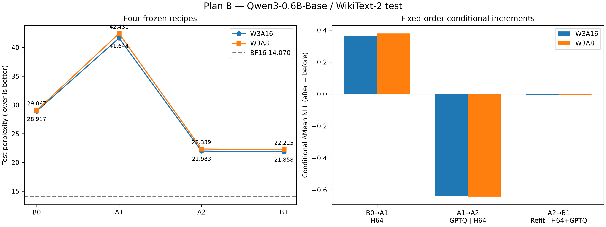
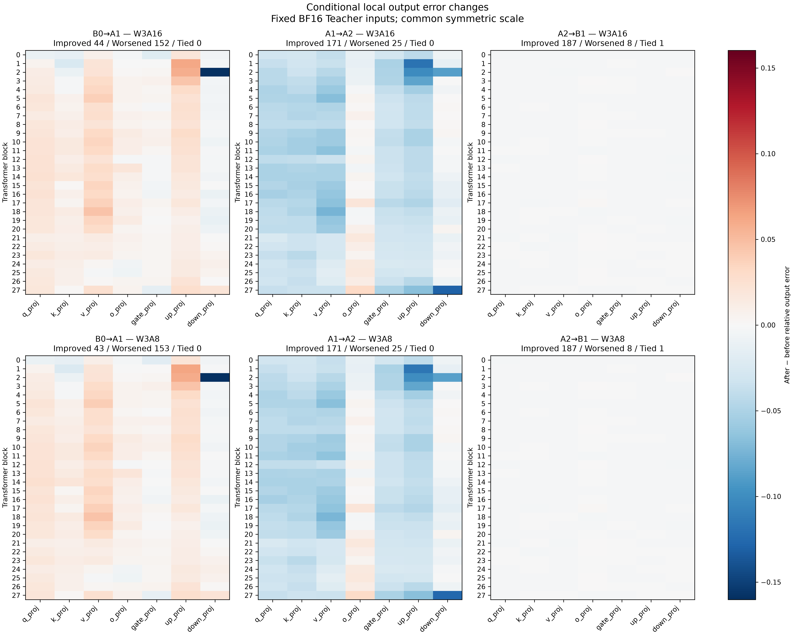
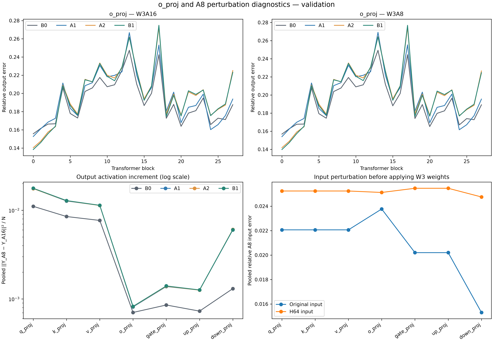

# Plan B W3A8 顺序消融研究报告

本轮已于 2026-10-14 完成工程、实际实验与分析。四种 Recipe 的八项完整 Test 评测、
1,024-token Smoke 和 4,096-token Validation 诊断全部通过验收；108 项测试通过且零跳过。
B0/B1 的四项 NLL/PPL 与历史值逐项严格相同，两个历史 payload 指纹保持不变。

主要观察是：H64 alone 在当前数值规格下使精度恶化；GPTQ given H64 提供最大的
条件收益；LUT Refitting 再带来较小的条件收益。o_proj 的 pooled 恶化主要发生在
GPTQ given H64，而较大的 A8 输入/输出扰动在 H64 alone 阶段已经出现。
这些结论限定于当前组合顺序、模型与数据协议，不证明组件的独立因果贡献。

## Test 主结果

共享历史 BF16 参考：Mean NLL 2.64401770896576，PPL 14.069617833591494。
以下八项量化结果全部来自本次完整评测；BF16 与历史局部统计的复用来源另行记录。

| ID | Recipe | W3A16 Mean NLL | W3A16 PPL | W3A8 Mean NLL | W3A8 PPL |
|---|---|---:|---:|---:|---:|
| B0 | Plain Lloyd-Max | 3.364441738 | 28.917349344 | 3.369588365 | 29.066559790 |
| A1 | H64 + Lloyd-Max | 3.729146419 | 41.643546831 | 3.747876575 | 42.430887453 |
| A2 | H64 + GPTQ | 3.090277596 | 21.983179578 | 3.106316739 | 22.338613741 |
| B1 | H64 + GPTQ + LUT Refitting | 3.084551277 | 21.857656609 | 3.101196535 | 22.224527808 |

## 固定顺序的条件增量

差值定义为 after − before；负 NLL/PPL 差值表示改善。
PPL 百分比使用当前步骤的 before 作为分母，不能直接相加。

| 条件步骤 | ΔMean NLL A16 | ΔMean NLL A8 | PPL change A16 | PPL change A8 |
|---|---:|---:|---:|---:|
| B0→A1 H64 given Plain | +0.364704680233 | +0.378288209380 | +44.008866% | +45.978361% |
| A1→A2 GPTQ given H64 | -0.638868822264 | -0.641559835753 | -47.211078% | -47.352942% |
| A2→B1 Refit given H64+GPTQ | -0.005726319254 | -0.005120203758 | -0.570996% | -0.510712% |

W3A8 中，H64 alone 的 PPL 增加 45.978361%；随后 GPTQ given H64 降低
47.352942%；Refitting given H64+GPTQ 再降低 0.510712%。最终 B1 相对 B0
的 PPL 降低 23.539187%。不能由此断言从 B1 删除 H64 会更好：本轮没有
评测未旋转的 GPTQ，也没有测量完整 factorial interaction。

A8−A16 的 Mean NLL 增量为：

| Recipe | A8−A16 Mean NLL |
|---|---:|
| B0 | 0.005146626969 |
| A1 | 0.018730156116 |
| A2 | 0.016039142627 |
| B1 | 0.016645258123 |

H64 步骤使该增量上升；GPTQ 步骤降低它；Refitting 又使它小幅上升，
但两种精度的总 NLL 均下降。该 Test 增量与 Validation 的 activation MSE
是不同测量，不能当作同一量的两种写法。



*Figure B1。左：四组 Recipe 的实际 Test PPL 与共享 BF16 参考。右：指定顺序
下的 Mean NLL 条件变化。Refitting 的变化幅度小于前两步，原始值保留在 CSV。*

## 验收与执行记录

| 检查 | 结果 |
|---|---|
| Implementation Acceptance | PASS；108 tests，零跳过 |
| Historical Baseline Acceptance | PASS；模型/Tokenizer/数据与 B0/B1 payload 身份一致 |
| Smoke Acceptance | PASS；1,024 validation tokens |
| Diagnostic Acceptance | PASS；4,096 validation tokens，独立权重/输出重算及 controls 核验 |
| Test / Experiment Acceptance | PASS；八项完整 Test，B0/B1 四项原始差值为零 |
| 源码冻结 | PASS；执行期间源码指纹不变 |
| 图表交付 | 三组 PNG/PDF 已导出，PNG 可读性已检查 |

整体执行耗时 2688.54 秒（44.81 分钟）；
主进程 peak RSS 3.50 GiB，子进程 peak RSS 5.10 GiB。
这些是本次 CPU 运行的资源记录，不构成硬件性能比较。

## 科研判断

| 判断 | 本轮证据结论 |
|---|---|
| H64 alone 改善此格式的 W3A8 精度 | 不支持；Test 与多数局部输出误差均恶化 |
| GPTQ given H64 提供条件精度收益 | 在测试范围内支持；A16/A8 NLL/PPL 均明显降低 |
| Refit given H64+GPTQ 提供条件精度收益 | 在测试范围内支持；收益较小，无跨 seed 方差估计 |
| o_proj 终点恶化主要由 Refit 引起 | 不支持；pooled 最大恶化位于 GPTQ given H64 |
| 较大 A8 扰动已在 H64 alone 阶段出现 | 支持；七类 pooled 输入误差和 196 层输出 activation MSE 均增大 |
| 组件具有可独立相加的因果贡献 | 未验证；只有固定顺序的消融 |

## 实验条件与公平性

实际起点为 main `e6a3adc1ac7f52fa37fb47d00f87c418dcdc5b31`。
四组 Recipe 依次为 B0 Plain Lloyd-Max、A1 H64 + Lloyd-Max、
A2 H64 + GPTQ（无 refit）、B1 历史 H64 + GPTQ + LUT Refitting。
固定设置见[协议](ablation_protocol.md)，数值格式见[规格](numerical_spec_v1.md)。
模型、Tokenizer、数据 revision、512-token train Calibration、4,096-token
Validation 与 32,768-token Test 均沿用已有记录。每个 Test 预测 32,736 个位置；
Mean NLL 为每个预测 token 的平均自然对数损失，PPL 为其指数。

准备阶段使用 4 个 CPU threads，诊断和 Test 使用 20 个，seed 42。
A1/A2 在任何 Test Forward 之前完成权重准备；prepare-only 不加载 Test。
本轮没有按 Validation/Test 结果修改量化参数。

196 层的 A1/A2 初始 LUT 完全一致，A1/A2/B1 的 signs 与 scales 完全一致，
A2 首轮 proxy objective 与历史 B1 trace 首项完全一致。A2 refit 次数均为零；
不对 GPTQ indices 做额外 nearest recoding。所有层的 dead_channels 均为零。
这些核验隔离了指定顺序下的组件增量，不能消除不同组件之间的交互。

BF16 参考分数和 B0/B1 的局部统计明确复用历史产物；八个量化 Test 配置全部
在当前实现中实际运行。新旧局部统计的 Teacher input/output hashes 与 FP32
controls 精确一致；三组 H64 controls 也精确一致。各 control 每层只保存一次。
输出汇总独立从 block SSE/energy/count 重算，weight error 独立从 checkpoint/payload
重建。该 reduction 检查不等于独立重跑原始 Forward。

## Validation 条件增量

分类沿用固定数值阈值，保留原始差值。这些计数是数值变化分类，不是统计显著性检验。
表中每个模式共 196 个层/投影，输入固定来自原始 BF16 Teacher。
原始记录见[逐层条件变化](../results/ablation/20261014/full/layer_increments.csv)和
[投影条件变化](../results/ablation/20261014/full/projection_increments.csv)。

| 条件步骤 | A16 改善 / 恶化 / 持平 | A8 改善 / 恶化 / 持平 |
|---|---:|---:|
| B0→A1：H64 given Plain | 44 / 152 / 0 | 43 / 153 / 0 |
| A1→A2：GPTQ given H64 | 171 / 25 / 0 | 171 / 25 / 0 |
| A2→B1：Refit given H64+GPTQ | 187 / 8 / 1 | 187 / 8 / 1 |

各投影的 pooled A8 Relative Output Error 如下，按 SSE 与 Teacher 能量加和后计算，
不平均逐层比值：

| Projection | B0 | A1 | A2 | B1 |
|---|---:|---:|---:|---:|
| q_proj | 0.14069895 | 0.15708032 | 0.12313053 | 0.12164233 |
| k_proj | 0.14780787 | 0.15516274 | 0.11910294 | 0.11797180 |
| v_proj | 0.20932137 | 0.22110283 | 0.19365726 | 0.19207552 |
| o_proj | 0.17971440 | 0.18263252 | 0.19810768 | 0.19802423 |
| gate_proj | 0.13125489 | 0.13029172 | 0.09294565 | 0.09166991 |
| up_proj | 0.17012128 | 0.18894285 | 0.14614130 | 0.14491626 |
| down_proj | 0.19197770 | 0.18323652 | 0.10835584 | 0.10778707 |

H64 alone 降低所有 196 层的相对 weight reconstruction error，但 A8 局部输出误差
恶化 153 层。随后 GPTQ 提高所有 196 层的 weight error，却改善 171 层的输出误差。
Refit 再降低 172 层的 weight error、提高 23 层、保持 1 层，同时改善 187 层的输出误差。
这组反向关系支持本设定中“未加权 Frobenius 权重误差不足以预测 Teacher-input
输出误差”的结论。输入方向加权的解释与代码中的 Hessian 目标一致，但本轮没有
直接测量跨 K64 block 的协方差能量，不能将特定失败归因于单一协方差机制。
Weight error 与 activation MSE 的增减计数按原始 FP64 差值符号统计；
输出 Relative Error 的改善/恶化/持平计数才使用协议中的固定数值阈值。



*Figure B2。A16/A8 三个相邻 Recipe 的原始输出相对误差差值，统一对称色阶；
负值表示误差降低。完整数值在 layer/projection increments 表中。*

## o_proj 恶化定位

`o_proj` 的 A8 pooled error 沿路径为
`0.17971440 → 0.18263252 → 0.19810768 → 0.19802423`。
相邻原始差值约为 `+0.00291811`、`+0.01547516`、`−0.00008344`。
在这个指定顺序和 pooled 指标下，最大恶化发生在 GPTQ given H64，
而不是 Refitting 的整体增量。

| 条件步骤 | o_proj A16 改善 / 恶化 / 持平 | o_proj A8 改善 / 恶化 / 持平 |
|---|---:|---:|
| H64 given Plain | 5 / 23 / 0 | 5 / 23 / 0 |
| GPTQ given H64 | 9 / 19 / 0 | 9 / 19 / 0 |
| Refit given H64+GPTQ | 20 / 8 / 0 | 20 / 8 / 0 |

Refit 的 pooled 改善很小，且其全部 8 个输出恶化层均为 `o_proj`。
这比“Refit 全面改善”更精确，也不支持“Plan A 的 o_proj 恶化主要由 Refit 导致”。
Plan A 的终点 B1 相对 B0 仍恶化 24 个 `o_proj` 层，但不能据此把这些层认定为
PPL bottleneck 或预测替换某个投影一定会降低全模型 PPL。

**机制推断。** 当前 GPTQ/Refit 目标使用 train Calibration 的 K64 block Hessian，
在 block 内补偿误差，并按 block proxy 接受 refit；它与完整 Validation 线性输出
误差和全模型 Test NLL 是不同目标。有限 Calibration 的分布差异、未建模的跨 block
协方差，以及在后续量化网络中的输入漂移，都可能影响 `o_proj` 的表现。
本轮仅定位条件步骤，没有把上述解释分别做实验隔离。

## A8 扰动增大

在 A1 的已有 Validation hook 内，分别计算原始/H64 输入的 E4M3 误差，不增加
Teacher Forward。三组旋转 Recipe 的 Teacher 输入、signs 和激活量化规则相同；
它们共享相同的旋转输入量化算子，但使用不同的重建权重。

| Projection | 原始输入 pooled relative A8 error | H64 输入 pooled relative A8 error |
|---|---:|---:|
| q_proj | 0.02206418 | 0.02524173 |
| k_proj | 0.02206418 | 0.02524173 |
| v_proj | 0.02206418 | 0.02524173 |
| o_proj | 0.02376893 | 0.02512183 |
| gate_proj | 0.02019986 | 0.02546443 |
| up_proj | 0.02019986 | 0.02546443 |
| down_proj | 0.01530631 | 0.02475479 |

七类投影的 pooled 输入误差均增大；H64 alone 已使全部 196 层的输出
activation increment MSE 增大。GPTQ given H64 又使 148 层增大、48 层降低；
Refit given H64+GPTQ 使 194 层增大、1 层降低、1 层不变。
因此，Plan A 观察到的较大 A8 扰动在 H64 alone 阶段已出现；后续权重更新继续改变
该扰动经重建权重传播后的大小。输入量化误差与输出扰动不能互相替代。

例如，`down_proj` 的 pooled output activation MSE 沿路径为
`0.00130665 → 0.00601628 → 0.00607026 → 0.00603506`，
而 A8 总相对输出误差最终明显下降。对每个实际 BF16 输出，定义
`e16 = Y_A16 − Y_Teacher`、`d = Y_A8 − Y_A16`，则 FP64 下恒有：

```text
a8_teacher_mse_delta = activation_increment_mse + 2 * sum(e16 * d) / N
```

这个带符号交叉项说明较大的 activation increment 不等于同比增加的总 Teacher
误差。`model.layers.2.mlp.down_proj` 在历史 B1 未接受任何 refit，A2/B1
局部结果相同；这也对应条件 Refit 统计中的唯一持平层。
跨投影的原始 MSE 具有不同输出尺度，本报告只在同一投影内比较其 Recipe 变化。



*Figure B3。逐层 o_proj A16/A8 输出误差、各投影 pooled activation increment
及 pooled 输入量化误差。所有局部数据来自同一 Validation 协议。*

## 后续研究建议

以下是下一阶段建议，尚未在本轮执行，也不是已经证实的改进效果。

1. **优先检查 o_proj 的目标失配。** 在同一模型、数据与 W3A8 格式下，对照 K64 proxy、
   完整 Calibration 线性输出误差和独立 Validation 输出误差。先检验跨 block
   项/Calibration 分布能否解释 GPTQ 步骤的恶化，再决定是否改变误差补偿或 refit
   的接受准则。新增对照的配置应在下一次 Test 前预先固定。
2. **研究 A8-aware LUT Refitting。** 当前目标使用未量化的 Calibration 输入；
   可在保留八项 E4M3 LUT、FP32 scales 和 W3 indices 的前提下，探索以实际
   `Q_A8(XR)` 和 Teacher 输出定义目标/验收，同时报告 A16/A8 总误差与交叉项。
   先在固定 Validation 上检查是否降低 A8 总误差，不能仅按 activation MSE 或
   weight Frobenius error 接受更新。
3. **针对 o_proj 做保持 W3A8 格式的算法选择对照。** 比较其保留 Plain/A1 或采用
   GPTQ/Refit 的最小全模型替换实验。局部误差仅用于提出候选，不据当前 Test
   分数反复挑选层；该对照才能检验局部恶化是否影响全模型 NLL。
4. **检查 H64 与现有 E4M3 激活规则的适配。** 当前七类 pooled 输入误差均增大；
   可围绕固定 K64 与相同量化格式，研究旋转/缩放对输入误差及权重传播后的总误差
   的联合影响。需要同时核验数值 controls 和权重/激活耦合，不能把去异常值或
   更小权重误差当作必然的 A8 精度收益。

以上建议不涉及新模型、新格式或 GPU Kernel，也不构成各组件独立贡献或新颖性结论。

## 证据边界与材料

这是单一模型、语料协议、seed 和 CPU 运行环境的顺序消融，没有跨 seed 方差或
跨数据集泛化估计。条件 NLL 差值可按本顺序相加，但不能解释成互不依赖的因果贡献；
PPL 的百分比变化也不作加法归因。局部测量来自固定 Teacher 输入，完整量化模型的
后续输入分布可以不同。

本轮为代码/产物自检，并包含独立数值重算与合成 oracle 测试；没有声称存在第二名
独立审阅者。模型和大型 payload 不入 Git，来源指纹、配置与完整日志随结果保存。

外部论文仅作为方法背景，核对范围为原始 arXiv 摘要：[GPTQ](https://arxiv.org/abs/2210.17323v2)
将方法定义为基于近似二阶信息的权重量化；[QuIP#](https://arxiv.org/abs/2402.04396v2)
将随机 Hadamard 与向量码本、微调组合使用。本轮实现与结论以仓库固定数值规格和
实际产物为准，不把其他完整 Recipe 的结果转移为 H64 alone 的保证。

完整记录在[本次实验目录](../results/ablation/20261014/)：

- [主结果](../results/ablation/20261014/summary.csv)、
  [条件 NLL/PPL 增量](../results/ablation/20261014/conditional_increments.csv)、
  [A8−A16 增量](../results/ablation/20261014/activation_increments.csv)。
- [逐层误差](../results/ablation/20261014/full/layer_errors.csv)、
  [投影汇总](../results/ablation/20261014/full/projection_summary.csv)、
  [条件逐层变化](../results/ablation/20261014/full/layer_increments.csv)、
  [条件投影变化](../results/ablation/20261014/full/projection_increments.csv)。
- [输入 block 统计](../results/ablation/20261014/full/input_block_stats.csv)、
  [输入层统计](../results/ablation/20261014/full/input_errors.csv)、
  [controls](../results/ablation/20261014/full/precision_controls.csv)、
  [输出 block 统计](../results/ablation/20261014/full/block_stats.csv)。
- [配置/来源/验收](../results/ablation/20261014/manifest.json)、
  [自动执行记录](../results/ablation/20261014/report.md)、
  [工程验收](../results/ablation/implementation/implementation_acceptance.json)、
  [测试日志](../results/ablation/implementation/implementation_tests.log)。

复现步骤及资源路径在 [README](../README.md#plan-b-quantization-ablation)。
