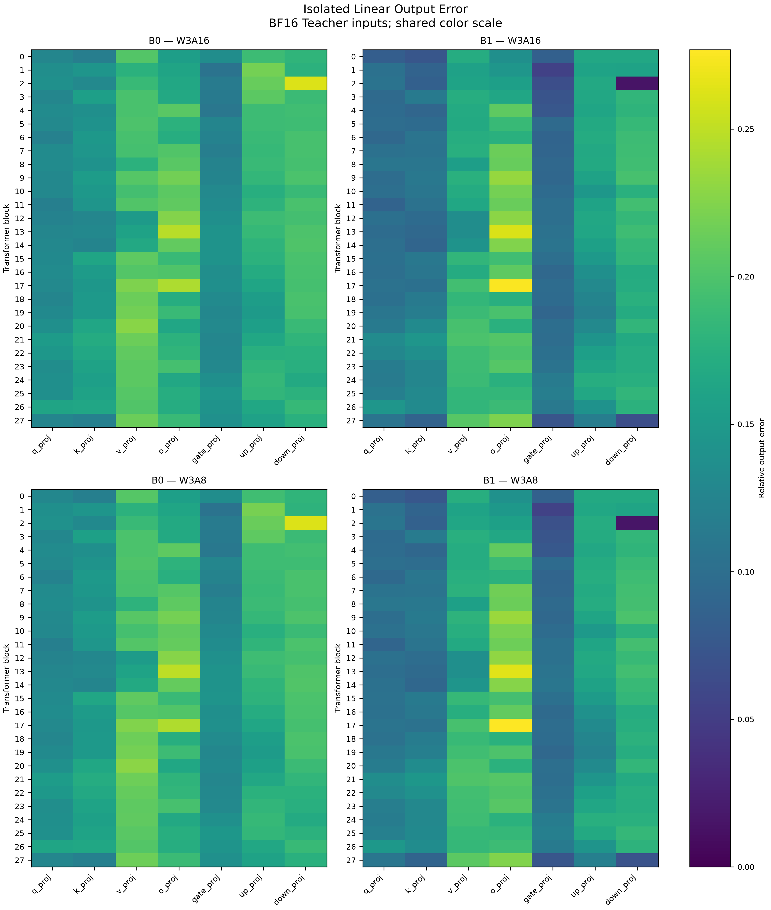

# Plan A layerwise diagnostic results

The accepted Plan A execution completed on 2026-10-14 after all eight historical
evaluations reproduced exactly. On fixed Qwen3-0.6B-Base teacher inputs, the
combined H64 + GPTQ + refitted-LUT recipe (B1) lowers relative output error in
170 of 196 layers in both A16 and A8. Its relative weight reconstruction error
and A8-versus-A16 activation increment MSE increase in all 196 matched layers.
These measurements describe the combined recipe under the frozen protocol.

The normative definitions, four CSV schemas, work budget, and stopping rules
remain in [Update Plan A](update_plan_a.md). This report records the execution
and results without changing that protocol.

## Execution and acceptance

| Acceptance | Result | Evidence |
|---|---|---|
| Implementation Acceptance | PASS; 91 tests, zero skips, plotting test passed | [Engineering record](../results/layerwise_diagnostics/implementation_acceptance.json), [test log](../results/layerwise_diagnostics/implementation_tests.log) |
| Historical Baseline Acceptance | PASS; both rebuilt payload fingerprints match exactly | [Historical manifest](../results/historical_rerun/20261013/manifest.json), [diagnostic preflight](../results/layerwise_diagnostics/20261014/manifest.json) |
| Smoke Acceptance | PASS; 1,024 validation tokens | [Smoke manifest](../results/layerwise_diagnostics/20261014/smoke/manifest.json) |
| Experiment Acceptance | PASS; 4,096 validation tokens and independent checks | [Execution manifest](../results/layerwise_diagnostics/20261014/manifest.json), [full manifest](../results/layerwise_diagnostics/20261014/full/manifest.json) |

Engineering checks can pass when model, data, or payload resources are missing.
That condition leaves historical/experiment acceptance blocked; it does not
authorize a formal experiment pass. The
[earlier resource preflight](../results/layerwise_diagnostics/20261013-preflight/manifest.json)
is retained as a BLOCKED record. The accepted execution is the separate
`20261014` directory.

The original three-mode evaluations and the five-row recipe comparison were
all rerun with 32,768 test tokens, 32,736 predicted tokens, and 20 evaluation
threads. All eight mean-NLL and PPL differences from their historical rows
are exactly zero. Both original sanity checks also passed. See the
[historical report](../results/historical_rerun/20261013/report.md).

Resource revisions are frozen in
[resource provenance](../results/historical_rerun/resource_provenance.json):
Qwen3-0.6B-Base checkpoint revision
`da87bfb608c14b7cf20ba1ce41287e8de496c0cd` and WikiText-2 revision
`b08601e04326c79dfdd32d625aee71d232d685c3`. Model, tokenizer, calibration,
evaluation, diagnostic token, payload, and source fingerprints are recorded
in the manifests. A payload mismatch stops historical acceptance; a rebuilt
or cross-platform payload is never automatically substituted for the baseline.

## Measurement protocol

The model is the original BF16 teacher. Hooks observe the same teacher input
and output at the seven projections in each of 28 transformer blocks; local
quantized outputs do not feed back into the teacher. B0 is plain Lloyd-Max,
and B1 is the frozen H64 + K64 GPTQ + Hessian-refitted E4M3 LUT recipe.
Calibration remains the first 512 train tokens. Diagnostics use the first
4,096 validation tokens, with a separate 1,024-token smoke run on their prefix.
No train-holdout fallback was used.

Each layer/token-block A16/A8 pair shares one `CachedLUTLinear` weight
reconstruction and follows its existing numerical path, including the
final BF16 output cast. Differences are promoted to FP64 before squaring.
FP32 unquantized controls are checked for exact cross-recipe agreement and
stored once per layer; H64 controls are computed for B1 and also stored once
per layer. The maximum control relative output error is `0.000281535780179104`.

For relative output errors `E0` and `E1`, the saved raw delta is `E1 − E0` and
the classification tolerance is
`tau = 1e-8 + 1e-6 * max(abs(E0), abs(E1))`.
Values below `−tau` improve, values above `tau` worsen, and the inclusive
interval `[−tau, tau]` is tied. Figure A2 displays raw deltas without threshold
clipping.

The diagnostic execution used the locked Python 3.14.4 / PyTorch 2.14.0+cpu
environment and 20 CPU threads. Its recorded elapsed time was 636.09 seconds
and peak process RSS was 3.56 GiB. These are execution metadata for this CPU
run, not a hardware performance comparison.

## Relative output error

The following projection summaries pool SSE and teacher energy across all
28 layers and four token blocks before applying the error formula. They are
not averages of layer ratios. Classification counts refer to paired layers.

| Projection | B0 A16 | B1 A16 | B0 A8 | B1 A8 | Improved / worsened / tied, each mode |
|---|---:|---:|---:|---:|---:|
| q_proj | 0.13975838 | 0.11995405 | 0.14069895 | 0.12164233 | 28 / 0 / 0 |
| k_proj | 0.14686200 | 0.11627817 | 0.14780787 | 0.11797180 | 28 / 0 / 0 |
| v_proj | 0.20791108 | 0.18983147 | 0.20932137 | 0.19207552 | 28 / 0 / 0 |
| o_proj | 0.17832616 | 0.19661876 | 0.17971440 | 0.19802423 | 4 / 24 / 0 |
| gate_proj | 0.13058067 | 0.09016563 | 0.13125489 | 0.09166991 | 28 / 0 / 0 |
| up_proj | 0.16906078 | 0.14281301 | 0.17012128 | 0.14491626 | 28 / 0 / 0 |
| down_proj | 0.19167023 | 0.10539717 | 0.19197770 | 0.10778707 | 26 / 2 / 0 |
| All layers | — | — | — | — | 170 / 26 / 0 |

Thus, 86.73% of layers improve in each mode. Six projection families have
lower pooled errors, while `o_proj` worsens. In A8, its pooled relative error
rises from 0.17971440 to 0.19802423. The two worsened `down_proj` layers coexist
with a substantial pooled improvement for that projection family.

*Figure A1. A16/A8 × B0/B1 relative output error, with a shared linear color scale.*

*Figure A2. Raw B1 − B0 relative output error, with a common symmetric color scale.
The classification counts use the fixed numerical tolerance.*

## Weight error and A8 perturbation

B1 relative weight reconstruction error is larger in every matched layer,
while its teacher-input output error is smaller in 170. On this fixed
protocol, unweighted Frobenius weight error alone does not predict local
output error. The observation concerns the combined recipe and does not
identify the separate effects of H64, GPTQ, or LUT refitting.

B1 also has larger activation increment MSE,
`||Y_A8 − Y_A16||² / N`, in all 196 matched layers and every pooled projection
family. This agrees in direction with the historical test mean-NLL activation
increment: 0.005146626969 for B0 and 0.016645258123 for B1. These are separate
local-validation and full-model-test metrics. B1 still has lower total output
error in most layers and lower test PPL:

| Recipe | Test W3A16 PPL | Test W3A8 PPL |
|---|---:|---:|
| B0 | 28.917349344449057 | 29.066559790365766 |
| B1 | 21.857656609021078 | 22.224527807599603 |

The signed derived metric
`a8_teacher_mse_delta = (SSE_A8 − SSE_A16) / N` measures the change in error
relative to the teacher. It includes the error cross term and can be negative,
unlike activation increment MSE. For B0
`model.layers.2.mlp.down_proj`, activation increment MSE is
`0.0005057392599864822` and the signed teacher MSE change is
`−0.0006620814263369468`. This observed cancellation comes from the existing
A16/A8 SSE records and requires no additional forward.

## Artifacts and independent verification

The accepted [full output directory](../results/layerwise_diagnostics/20261014/full/)
contains the fixed schemas from Plan A:

| Artifact | Full rows | Independent verification source |
|---|---:|---|
| [layer_errors.csv](../results/layerwise_diagnostics/20261014/full/layer_errors.csv) | 392 | Output metrics reduce from block statistics; weight statistics rebuild separately from checkpoint and payload |
| [projection_summary.csv](../results/layerwise_diagnostics/20261014/full/projection_summary.csv) | 14 | Pool independently reduced layer statistics, counting each weight once |
| [precision_controls.csv](../results/layerwise_diagnostics/20261014/full/precision_controls.csv) | 392 | Block control SSE, hashes, counts, and energy; check duplicate FP32 controls before reduction |
| [block_stats.csv](../results/layerwise_diagnostics/20261014/full/block_stats.csv) | 1,568 | Per-forward sufficient statistics and input/output/control hashes |

Output recomputation verifies the reduction from block sufficient statistics;
it is not an independent rerun of the original forward or tensor SSE.
Weight error is independently checked by rebuilding weights from original
BF16 checkpoint weights and LUT/indices/scales, followed by the frozen inverse
rotation for B1, without a forward. Both stages check fixed coverage and finite
values, and the full stage checks exact agreement with the smoke prefix.
PNG and PDF plots accompany the
CSV files; the [execution report](../results/layerwise_diagnostics/20261014/report.md)
and manifests preserve the complete measurements and checks.

These local errors do not establish layer PPL sensitivity, per-step causal
attribution, performance on another model/dataset, or Rubin hardware behavior.
Reproduction commands and resource handling are documented in the
[README](../README.md#plan-a-layer-diagnostics).
